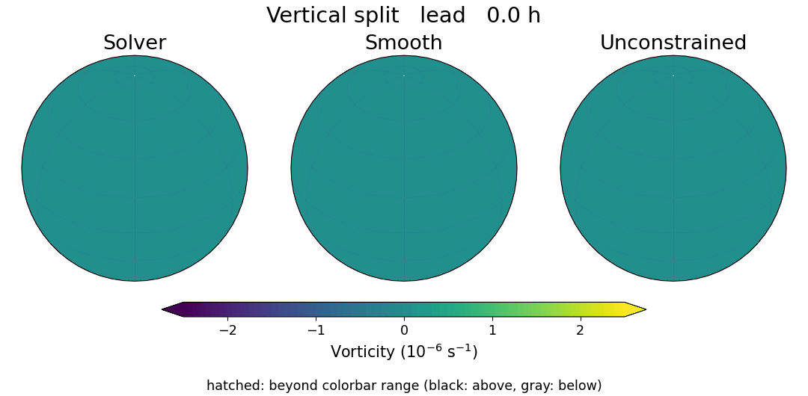
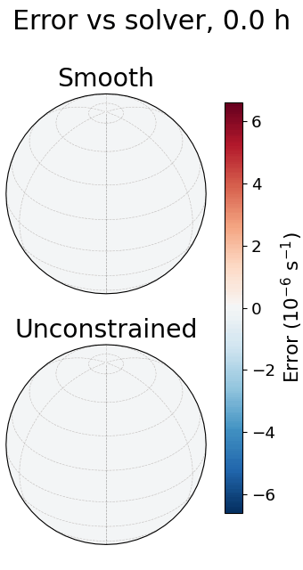
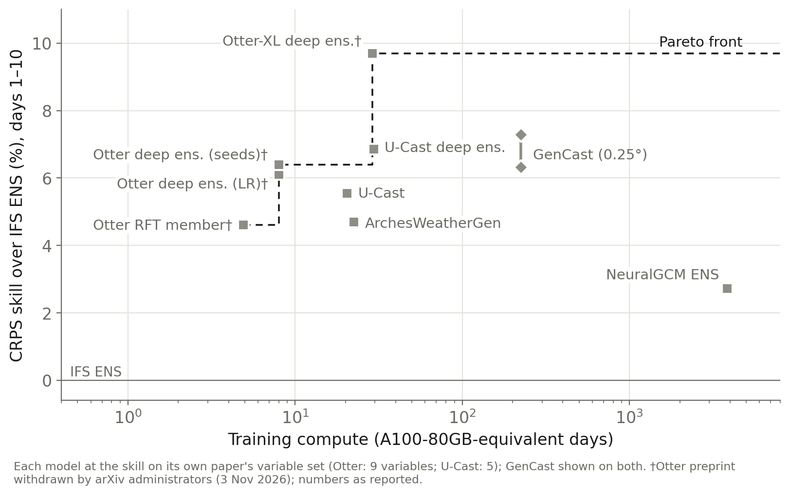
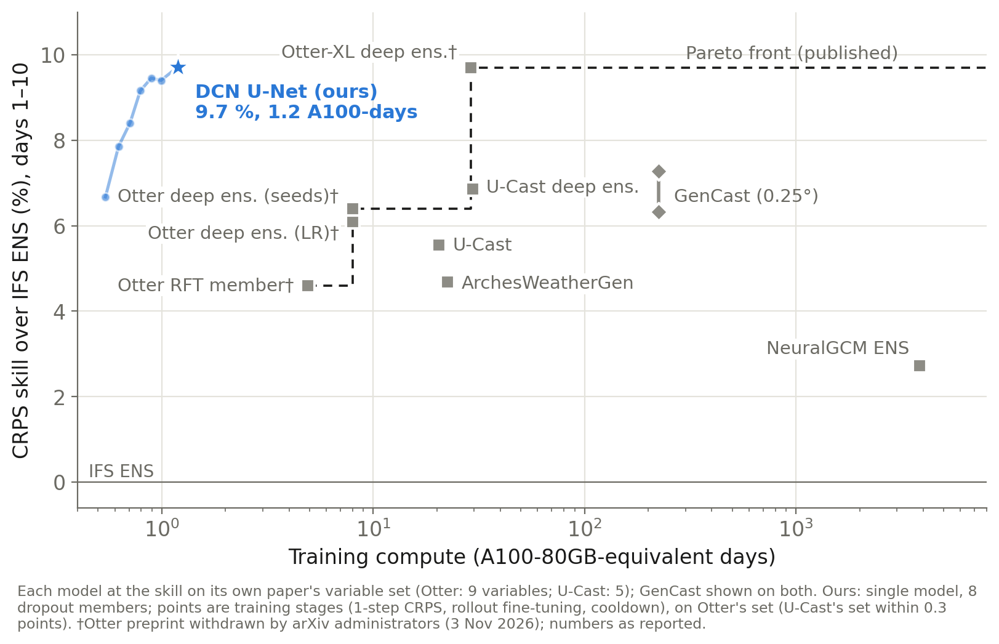
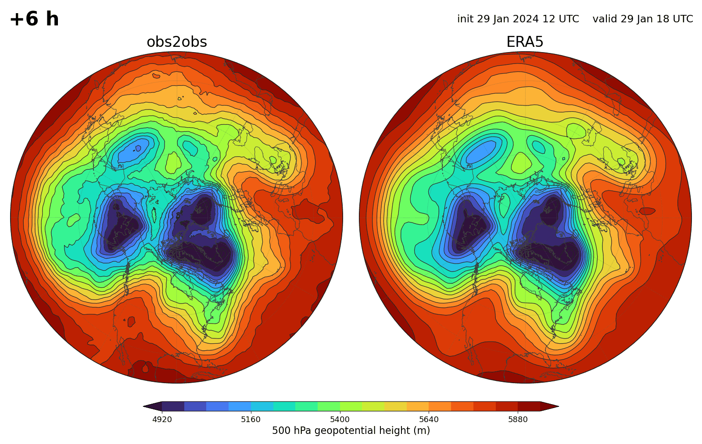
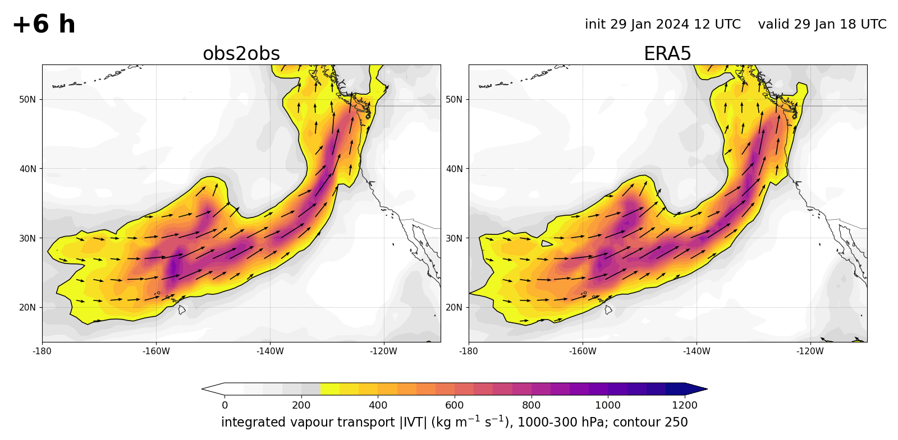
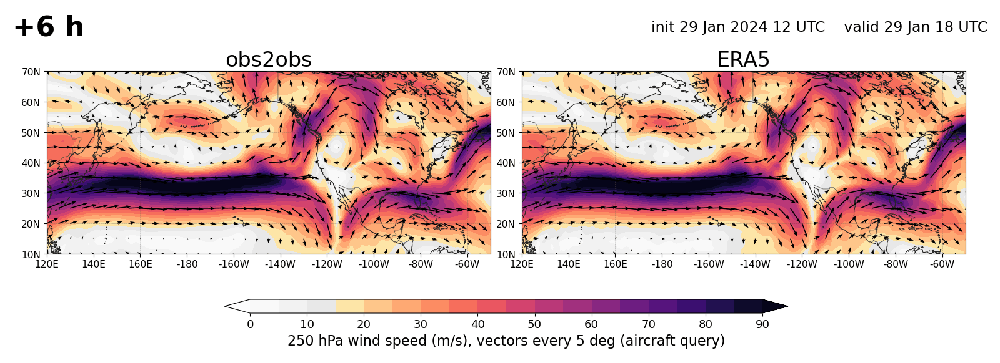
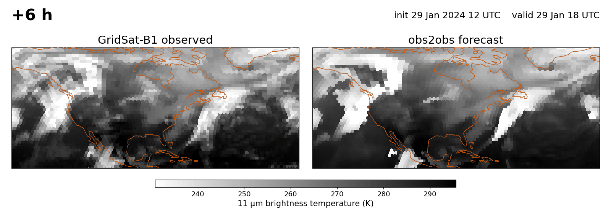
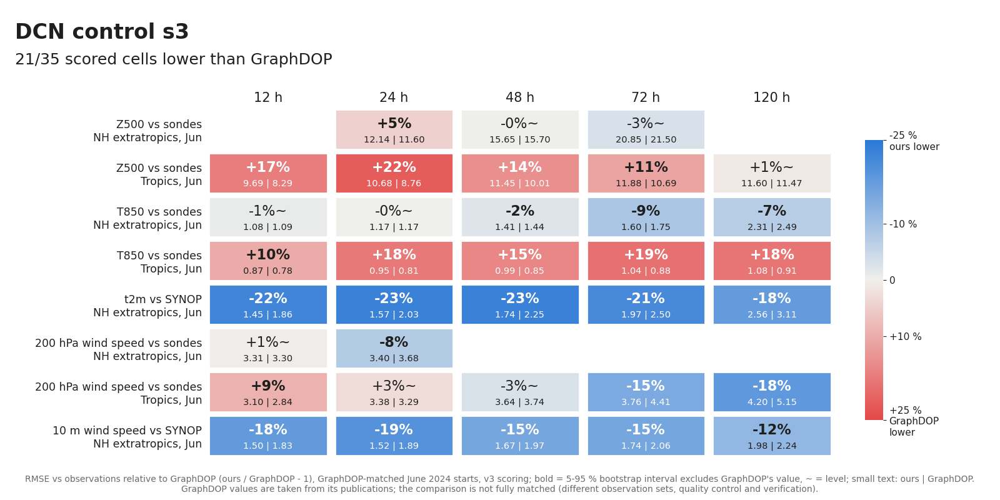

# Smooth Spectral Weights Make SFNOs Local and More Generalizable

##

<!--
One-line pitch: a tiny penalty on how jagged the SFNO's spectral weights are gives
much more stable forecasts on flows the model has never seen.
Testbed: shallow water equations on the sphere.
-->

---
layout: default
---

# Motivation: weather is local

- Most ML weather models (SFNO, transformers, …) have a **global receptive field** at every step
- Physically, over one short time step a point only "feels" its neighbourhood
  - the far side of the planet shouldn't matter
- Lots of parameters + global connections → room for **shortcut learning**
  - memorizing training-set correlations instead of learning the dynamics
- Symptom: great in-sample, then blow-ups or ringing **out of distribution (OOD)**

 

> A changing climate *is* an OOD problem.

---
layout: default
clicks: 1
---

# SFNO in one picture

- SFNO layer: spherical harmonics → **multiply each degree $l$ by a learned weight** → back to grid
- **Multiplying in spectral space = convolving in grid space:** every layer secretly applies a kernel on the sphere
- The kernel's shape is set entirely by how the weights vary with $l$

<SpectralKernelDemo :smooth="$clicks >= 1" />

<!--
Start: jagged weights -> kernel with rings all over the sphere, little energy near the source.
Click: weights morph to a smooth curve -> kernel collapses to a compact blob around the source.
Cartoon with synthetic weights (energy readout = fraction within 20 deg of the source).
-->

---
layout: default
---

# The idea: jagged in spectral space = ringing in grid space

- Same intuition as **Gibbs ringing** in Fourier series
  - jagged weights across $l$ → kernel with long-range oscillatory side lobes (**nonlocal**)
  - smooth weights across $l$ → kernel energy concentrated near the source (**local**)
- **Our fix:** penalize the curvature of the weights across degree $l$
  - a 1-D Laplacian (second difference), one knob $\lambda$
- Neighbouring wavenumbers are neighbouring length scales → the physical response should vary smoothly between them
- Cheap: no architecture change, no extra inference cost

---
layout: default
---

# Experimental setup

- Two arms, **identical except for the penalty**
  - **Unconstrained:** $\lambda = 0$
  - **Smooth:** $\lambda = 10^{-5}$
- Same small SFNO (4 layers, width 32), **8 random seeds per arm**
- Deliberately **data-limited** training
  - 50 random-IC shallow-water trajectories
  - 1-step, then 2-step autoregressive training; same number of updates for both arms
- OOD test: **"vertical split"** — one half of the sphere raised, nothing like the training data

---
layout: image-right
image: /figures/kernel_extent_full.png
imageBackground: white
imageCaption: "Kernel energy within radius r (source at 30°N); thin lines = seeds"
---

# Result 1: kernels become local

- Each layer's kernel = its response to a point source
- What fraction of its energy lies within radius $r$?
- **Within 20°: Smooth ≈ 94 % vs Unconstrained ≈ 24 %**
- Unconstrained kernels spread their energy across the globe; smooth kernels are compact
- Consistent across all 8 seeds, insensitive to source location

---
layout: image-right
image: /figures/2_step_sensitivity.png
imageBackground: white
imageCaption: "Cumulative 2-step input sensitivity vs distance"
---

# Result 2: the whole model behaves like the solver

- Kernels are per-layer — what about the full network?
- Jacobian: how much does the 2-step output at a point depend on inputs at distance $r$?
- Within 10°:
  - **Smooth 98.8 %**
  - **Solver 99.0 %**
  - **Unconstrained 83.7 %**
- Unconstrained: ~8 % of its sensitivity from > 20° away — spurious long-range influence

---
layout: image-right
image: /figures/RMSE_vs_lead_VS.png
imageBackground: white
imageCaption: "Vertical split: normalized RMSE vs lead, mean and min–max over 8 seeds"
---

# Result 3: OOD generalization

- **Vertical split** initial condition — never seen in training
- **Unconstrained:** mean error exceeds 1 after ~1 day; median seed ~1e8 by 100 h (blown up)
- **Smooth:** below 0.4 through 50 h; median ~1.2 at 100 h

---
layout: default
---

# Result 3: what the forecasts look like

  
  

Vertical split, first 24 h, median seed of each arm; errors share one color scale. 
<b>Even the worst Smooth seed beats the best Unconstrained seed</b> over the first 10 h.

---
layout: default
---

# Takeaways

- SFNO layers are convolutions in disguise: **smooth spectral weights → local kernels**
- A one-line penalty makes kernels and full-model sensitivities look like the true solver
- **Large gain in stability and OOD skill**
- Locality is a useful, cheap inductive bias for ML weather and climate models

---
layout: section
---

# Pushing the Pareto Frontier on Probabilistic Weather Forecasts

## Sphere-aware dynamic convolutions for cheap, skilful ensembles

### And the Unreasonable Performance of Dynamic Deformable Convolutions

<!--
Project 2. Pitch: how much forecast skill per GPU-day, and which design choices buy it.
-->

---
layout: default
---

# The question

- ML weather models now match or beat the operational ECMWF ensemble (**IFS ENS**) on CRPS at medium range 
- The leading models cost **hundreds to thousands of GPU-days** to train 
  - that limits who can build, retrain or study them

 

> **How much forecast skill can we get per unit of training compute, and which design choices buy it?**

<!--
One compute unit throughout: A100-80GB-equivalent GPU-days.
-->

---
layout: default
---

# The Pareto front: skill vs training compute

Each model = one point. **On the front:** no other model is both cheaper *and* better. Progress moves the front **up and to the left**.

y: CRPS skill over IFS ENS = 1 − CRPSmodel/CRPSIFS ENS, mean over variables and days 1–10; 0 % = IFS ENS.

<!--
Current state of the published front. Otter and U-Cast define it at about 30 A100-days; GenCast sits about 225 A100-day equivalents. †Otter preprint withdrawn by arXiv administrators; numbers as reported.
-->

---
layout: default
---

# Two recent front-pushing papers

**U-Cast** (Rühling Cachay, Watson-Parris & Yu, ICML 2026)
- Specialised weather architectures are *"unnecessary for frontier performance"*
- A standard U-Net matches or exceeds GenCast and IFS ENS at 1.5°, with **>10× less** training compute

**Otter Weather**† (Diaconu et al., 2026)
- An efficient, general spatio-temporal model at 1.5°
- Otter-XL: **9.7 %** CRPS skill over IFS ENS with ~10× less compute than GenCast

 

> Common thread: **general-purpose architectures + an efficient training curriculum**, no domain-specific inductive biases. No custom architectures or custom GPU kernels

† Preprint withdrawn by arXiv administrators, 3 Nov 2026; numbers as reported.

<!--
[CITE arXiv:2604.09041; arXiv:2606.26421]
-->

---
layout: default
---

# Our angle

- My prior: these claims were wrong, and an SFNO (which neither paper compared against) would beat both. **I was wrong.**
- **Convolutions:** a great inductive bias for weather (locality), inherent spatial understanding…
  - But a bad one on the sphere: a 3 × 3 stencil collapses near the poles
  - Fixed weights/not context-dependent 
- **Attention:** powerful because it is content-aware…
  - But has shortcomings on spatial data (no time to get into this)

 

> Keep their efficient staged recipe, but build **sphere geometry** and **flow-dependent (dynamic) kernels** into the network. Where does that put us on the front?

---
layout: default
---

# The network I was looking for: DCNv4

- **Deformable ConvNets v4** (Xiong et al., January 2024)*: a dynamic/content aware deformable convolutional kernels, built for computer vision
- It keeps the **locality** of a convolution and adds the **content-awareness** of attention, at roughly the cost of a convolution; can insert my own fixes for spherical geometry
- Benchmarked on **image classification**, segmentation and image generation
- It never displaced the vision transformer, and has seen little use since

 

> Exactly the inductive bias I wanted for weather, but built for images. To use it on a forecast grid, it has to learn the sphere.

*Y. Xiong et al., "Efficient Deformable ConvNets: Rethinking Dynamic and Sparse Operator for Vision Applications," arXiv:2401.06197 (2024).

<!--
DCNv4 = the fourth DCN generation from the OpenGVLab group (DCNv1 2017, DCNv2 2019, DCNv3/InternImage 2023 [CITE]). Released as a tech report with code (github.com/OpenGVLab/DCNv4).
"Never caught on": my read of its uptake relative to ViTs; say it as an opinion.
Bridge to next slide: what "dynamic" and "deformable" mean, then how we made it spherical.
-->

---
layout: default
clicks: 2
---

# The DCN: fixed → dynamic → deformable

A convolution computes each output point as a **weighted sum of nearby grid values**. Each value it reads is a **tap**: a 3 × 3 kernel has **9 taps**, each with its own **weight**.

<DynamicConvDemo :stage="$clicks" class="mt-2" />

Like attention, the weights depend on the input, but they stay <b>local</b> and are <b>not softmax-normalised</b> (≈ half negative). Cost ≈ a convolution.

<!--
Start: standard conv, the same 9 weights (a smoother) wherever the kernel goes.
Click 1: dynamic weights. A small generator network (3×3 depthwise conv + linear map, DCNv4) reads the local features and recomputes the 9 weights at every grid point and every 6 h step. Cartoon rule: smoother in flat regions, derivative across the front.
Click 2: the same generator also predicts an offset for each tap, so the taps move off the grid (cartoon: shifted upstream and stretched along the front); off-grid values are read by bilinear interpolation. In the trained model the offsets do follow the wind upstream.
Cartoon: synthetic field, hand-made rules. DCNv4: Xiong et al. 2024, arXiv:2401.06197.
-->

---
layout: default
clicks: 1
---

# The DCN: building the sphere in

- On a lat–lon grid, cells **shrink toward the poles**, so a 3 × 3 stencil in grid space collapses on the globe
- **Equal-area stencil:** taps placed at **equal physical distance on the sphere**, so it keeps its size (and widens in grid space)

<SphereStencilDemo :stage="$clicks" class="mt-2" />

Equal-area taps add <b>+1.28 percentage points</b> of CRPS skill over IFS ENS (same seed, same training stage)

<!--
Start: grid stencil only; as the centre moves poleward, on the globe its east-west spacing shrinks as cos(latitude) (readout in km).
Click: equal-area stencil added (gold); on the globe it keeps its size, on the grid it widens. Cartoon uses 10-degree cells; the model grid is 1.5 degrees.
Gain grows with lead time, mostly better-calibrated spread; Otter / U-Cast sets 6.67 / 6.96 % vs 5.39 / 5.82 %. [CHECK] single seed; replicates running.
Spherical padding: periodic in longitude, reflected across the poles with a 180-degree shift.
-->

---
layout: default
---

# Shared setting

- **Data:** ERA5 at 1.5° (WeatherBench2, 121 × 240), 6-hourly
  - input: two consecutive states of 83 variables (6 on 13 pressure levels + 5 surface), solar forcing, static fields
- **Split:** train 1979–2019, validate 2021, **test 2020** (the papers' test year)
- **Score:** CRPS skill over IFS ENS, days 1–10, 2020 forecasts at 00/12 UTC, on Otter's and U-Cast's variable sets
- **Compute:** every training stage counted, in A100-80GB-equivalent days

<!--
weatherbench 2 is what otter and ucast were trained on

otter and ucast use slightly different variable sets, but i put their skill on the same plot to simplify, because differences are small.
-->

---
layout: default
---

# Results: the Pareto front

- **DCN U-Net (ours): 9.7 % at 1.2 A100-days** (single model, 8 dropout members) vs Otter-XL deep ens.† 9.7 % at 29 A100-days (**~24× the compute**)
- Above U-Cast deep ens. (6.9 %) and GenCast (6.3–7.3 %); most of our gain comes from cheap rollout fine-tuning (6.7 → 9.7 % for ~0.6 A100-days)

<!--
We sit above and to the left of the published front, at about 1/25 of its compute. †Otter preprint withdrawn; numbers as reported.
-->

---
layout: default
---

# Conclusions

- **The front moved:** 9.7 % CRPS skill over IFS ENS for **1.2 A100-days**
  - equals the best published 1.5° result (Otter-XL†, ~24× the compute); beats U-Cast deep ens. Beats GenCast with ~225x less compute
- **Inductive biases still pay in the cheap regime**
  - respecting the sphere (equal-area stencil) adds ≈ 1.3 skill points on its own
- **Locality + content-awareness:** dynamic kernels keep the locality of convolutions and gain the input dependence of attention, at about the cost of a convolution
- **Actual usefulness of these models is up for debate**
  - Low resolution
  - Minimizing CRPS does not guarantee a "useful model"

† Otter preprint withdrawn by arXiv administrators; numbers as reported.

---
layout: section
---

# Ragged Attention for Obs to Obs Forecasting

## obs2obs: observation-to-observation forecasting with ragged attention

<!--
Project 3. Pitch: skip the analysis entirely. Learn to forecast future observations from past observations,
and do it well by letting the encoder read irregular observations directly with ragged attention.
-->

---
layout: default
---

# Why go observation to observation?

- Today's forecasts, physical *and* ML, start from an **analysis**: data assimilation with an NWP model
  - Running on analysis ties  model runs to analysis schedules, which are delayed and run only a handful of times a day
  - Running purely on obs avoids needing to wait for an analysis cycle
- ML forecasters are trained on reanalyses such as **ERA5**
  - **Learning from a model inherits that model's biases and errors**
- **obs → obs** avoids this: real measurements as targets, no NWP or reanalysis anywhere in the loop, scored only against future observations

 

> GraphDOP (ECMWF) showed obs → obs forecasting is feasible .
> **Can we do it better, by changing how observations get into the model?**

<!--
Key line: a model trained on ERA5 can at best learn ERA5, warts included. Observations are the ground truth
the analysis was built from.
-->

---
layout: default
---

# Why obs → obs is hard for ML

- Observations are **irregular in space and time**
  - satellite swaths, aircraft tracks, scattered stations, and big gaps over oceans and poles
  - every instrument reports at its own times
  - they **don't live on a grid**
- CNNs, vision transformers and neural operators all expect a fixed grid
- Conventional workarounds lose information or are slow

---
layout: default
clicks: 3
---

# The ragged-attention encoder

Every latent grid point draws a **radius** around itself (~250 km ) and attends to **whatever observations fall inside**, from any instrument, at their exact positions and times.

<RaggedAttentionDemo :stage="$clicks" class="mt-2" />

Each observation is a token: values + instrument + position relative to the grid point (rotary embeddings in a local frame on the sphere). Nothing is binned or interpolated.

<!--
Start: irregular observations over the regular latent grid they don't sit on.
Click 1: one grid point draws its radius and attends to every observation inside (line opacity = attention weight).
Click 2: the radius moves between grid points; the count changes from hundreds to zero (stations -> swath -> corridor -> empty ocean).
Click 3: all grid points at once, labelled by how many observations they see. Conventional attention needs a fixed
number of tokens per query (pad to the densest spot on Earth, or attend to everything); ragged attention packs the
variable-length lists into one fused kernel, so cost scales with the real (grid point, observation) pairs.
Cartoon with synthetic observations. [TODO: final version could use a real window's counts.]
-->

---
layout: default
---

# Data and model

**18 observation sources**, 2015–2023 train · 2024 val · 2025 test
- **Conventional:** radiosondes, dropsondes, surface & marine stations, aircraft (incl. humidity), wind profilers
- **Microwave:** ATMS, AMSU/MHS, SSMIS, AMSR-2
- **Infrared:** IASI & CrIS (**PCA-compressed** inputs, 40 PCs; **super-obbed** targets), GridSat geostationary IR
- **Other:** AMVs, GNSS-RO, ASCAT backscatter, altimetry, sea ice, ocean profiles
- Own QC, no NWP background

  
<b>Ragged-attention encoder</b> observations from two 6 h windows → latent grid (128 × 256, ~156 km)

  
↓

  
<b>Stepper:</b> DCN U-Net on the sphere, <b>6 h time step</b>

  
↓

  
<b>Decoder:</b> query any location, time and instrument; attention over the k nearest latent points

Trained end to end from scratch, on up to <b>3 autoregressive rollout steps</b> (18h) in only 27 hours on a single GH200

<!--
The stepper is the same DCN U-Net as project 2, adapted to the pole-free latent grid.
Longer forecasts: iterate the stepper, decode wherever you want.
-->

---
layout: default
---

# A 5-day forecast vs ERA5

500 hPa height, decoded on a 1° grid as if radiosondes were everywhere · ERA5 shown for reference only, never seen by the model

<!--
Free-running cycled forecast from 29 Jan 2024 12 UTC; no real observations after the start.
z500 RMSE vs ERA5 (20-90N): ~15 m at 24 h, ~32 m at 72 h, ~46 m at 120 h. Run 2 three-step, scene-derived geom leak blocked (leaky version: 14/27/41 m).
Small wiggles over Greenland / high orography are real model artefacts.
If asked: scene-derived geometry leak blocked here; the future observation layout (positions, AMV heights, sonde significant levels) is still used in the cycled rollout.
-->

---
layout: default
---

# An atmospheric river hits the West Coast

Integrated vapour transport (1000–300 hPa), same forecast · humidity and winds decoded as if radiosondes were everywhere

<!--
Same free-running forecast. The "9"-shaped river makes landfall in Oregon / northern California around 31 Jan 00-12Z.
Landfall shape and timing right; peak 921 vs 1001 kg/m/s at +42 h, but too weak 6 h earlier (493 vs 776); overdoes the next plume into southern California after day 3.
IVT RMSE vs ERA5: ~47 at 24 h, ~55 at 72 h, ~73 kg/m/s at 120 h. Scene-derived geom leak blocked.
-->

---
layout: default
---

# The jet stream, 5 days out

250 hPa wind speed and direction, same forecast · decoded as if aircraft were everywhere

<!--
Pacific jet streak, the sharp trough over Mexico (the near-zero-wind line is real) and the eastern North America trough all tracked.
Slightly smoother and a few m/s weak at the peaks. Vector wind RMSE vs ERA5: ~4.3 m/s at 24 h, ~7.9 at 72 h, ~10.4 at 120 h. Scene-derived geom leak blocked.
-->

---
layout: default
hide: true  # hidden 2026-11-10: cycled rollout leaks scene-derived geom (see results_geom_leak_test.md)
---

# Predicting what the satellite will see

GridSat-B1 11 µm brightness temperature over North America and the Atlantic, same forecast, decoded at the real satellite cells · cold cloud tops are white

<!--
Same forecast as the previous slide. The decoder is asked "what would the geostationary imager report here?"
Fronts and the big cloud systems are placed right out to several days; fine-scale texture is smoother than reality.
[DRAFT: DCN control three-step; rerun with run 2]
-->

---
layout: default
hide: true  # hidden 2026-11-10: cycled rollout leaks scene-derived geom (see results_geom_leak_test.md)
---

# Results: vs GraphDOP, on one GPU

Lower than GraphDOP in <b>21 / 35</b> scored lead × variable cells [DRAFT: DCN control; update with run 2]

<b>GraphDOP:</b> 64 × H100, 70 k steps · <b>obs2obs:</b> 1 × GH200, ~[TBD] GH200-hours

GraphDOP values from their papers [CITE]; observation sets, QC and verification differ, so this is not a matched comparison. GraphDOP wall-clock not reported.

<!--
Point is the device count, not an exact compute ratio. Don't show lead-0 numbers.
[TODO: swap in run 2 three-step numbers Wednesday morning.]
-->

---
layout: default
---

# Takeaways

- **obs → obs** training avoids inheriting a model's biases: the targets are the measurements themselves
- **Ragged attention** lets the encoder read irregular observations directly, at their real positions, at any density
- **Ragged attention + the DCN U-Net** let the whole model train from scratch in **~27 GPU-hours on a single GH200**
- This is a compute-efficient and viable way forward for obs to obs modeling
- **Next:** Keep improving model architecture, more data, better QC, etc...

<!--
~27 GH200-equivalent hours for the model shown (run 2 three-step): one-step 4.7 (epochs 0-4, run on 4 x A100 = 24 A100 GPU-h, converted at the measured GH200 rate) + 12.3 (epochs 5-17, GH200) + ~9.7 (cyc2 + cyc3 epoch 0, GH200).
Not counted: a 0.3 h failed start, smoke tests, evaluation. GraphDOP for scale: 64 x H100, 70 k steps (wall-clock not reported).
-->

---
layout: default
hide: true
---

# Backup: run 2 vs previous best, by lead and source

<b>[PLACEHOLDER]</b> error vs lead (6–120 h), run 2 vs DCN control, same code and validation  
Per-source at one step: GridSat −3.9 %, ocean profiles −3.3 %, ATMS −2.1 %, ASCAT −2.1 %, sondes −1.2 % [TBD: refresh at three steps]

